# JOONS

MCP-Based AI Infrastructure Ecosystem

JOONS는 AI 에이전트를 도구, 컴퓨터, 지식, 신뢰할 수 있는 실행 시스템과 연결하는 MCP 중심 AI 인프라 생태계입니다.


[English](README.md)

## Why JOONS

에이전트를 도구에 연결하는 것은 MCP 시스템의 한 부분입니다. 개발자에게는 신뢰할 수 있는 실행, 작업 할당, 진단, 도구 연결도 필요합니다. JOONS는 이 역할을 MCP 중심으로 모읍니다. JOONS CORE는 중심 서버이며 라이브러리와 도구는 CORE를 보완하거나 독립적으로 사용합니다.

## Who it is for

- MCP를 통해 AI 에이전트를 도구와 데이터에 연결하는 개발자
- 독립적인 신뢰성 또는 작업 할당 라이브러리를 찾는 Python 개발자
- 참조 패턴이나 프로토콜 진단을 살펴보는 MCP 개발자
- 제품 상태와 경계를 명확하게 파악해야 하는 운영자

## Ecosystem map

```mermaid
flowchart TD
    Agent["AI agents"] --> CORE["JOONS CORE MCP server"]
    CORE --> External["External tools and data sources"]
    Allocator["JOONS Allocator"] -. "optional hooks" .-> Guard["JOONS Agent Guard"]
    Toolkit["JOONS MCP Toolkit"]
    Probe["JOONS MCP Probe Preview"]
    Diff["JOONS MCP Diff Preview"]
    PolicyGate["JOONS MCP Policy Gate Preview"]
    MockServer["JOONS MCP Mock Server Preview"]
    ContractRunner["JOONS MCP Contract Test Runner Preview"]
    ReportHub["JOONS MCP Report Hub Preview"]
    SchemaKit["JOONS MCP Schema Toolkit Preview"]
    ToolCatalog["JOONS MCP Tool Catalog Preview"]
    TestData["JOONS MCP Test Data Generator Preview"]
    ContextBudget["JOONS MCP Context Budget Preview"]
    SearchEngine["JOONS Search Engine Preview"]
    AuditTrail["JOONS MCP Audit Trail Preview"]
    classDef private fill:#d3d3d3,stroke:#4F46E5,color:#000
    classDef public fill:#90ee90,stroke:#4F46E5,color:#000
    classDef preview fill:#ffa500,stroke:#4F46E5,color:#000
    classDef planned fill:#add8e6,stroke:#4F46E5,color:#000
    class CORE private
    class Toolkit public
    class Guard,Allocator preview
    class Probe,Diff,PolicyGate,MockServer,ContractRunner,ReportHub,TestData,SchemaKit,ToolCatalog,ContextBudget,SearchEngine,AuditTrail preview
```



이 개념도는 독립 제품이 CORE에 내장되어 있다는 뜻이 아닙니다. 현재 구현된 라이브러리 간 연동은 Allocator의 선택적 Guard 훅뿐입니다.

| 제품 | 핵심 질문 | 역할 | 상태 | 링크 |
|---|---|---|---|---|
| JOONS CORE | AI가 무엇을 할 수 있나요? | MCP 서버와 도구 실행 | 비공개, 운영 중; 소스 미공개 | 없음 |
| JOONS Agent Guard | 안전하게 실행되나요? | 신뢰성과 보호 | 공개, v0.1.0 Preview | [저장소](https://github.com/dbdefault/joons-agent-guard) |
| JOONS Allocator | 누가 어떤 작업을 하나요? | 작업 할당 | 공개, v0.1.0 Preview | [저장소](https://github.com/dbdefault/joons-allocator) |
| JOONS MCP Toolkit | 어떻게 만들어야 하나요? | 개발 참조 자료 | 공개 참조 구현, 초기 단계 | [저장소](https://github.com/dbdefault/joons-mcp-toolkit) |
| JOONS MCP Probe | MCP 서버가 올바르게 동작하나요? | 진단과 검증 | Public, v0.1.0 Preview | [저장소](https://github.com/dbdefault/joons-mcp-probe) |
| JOONS MCP Diff | 무엇이 바뀌었고 에이전트에 문제가 생길까요? | MCP 개발 도구: 계약 비교 | 공개, v0.1.0 Preview | [저장소](https://github.com/dbdefault/joons-mcp-diff) |
| JOONS MCP Policy Gate | 이 도구 목록이 우리 규칙을 따르나요? | MCP 개발 도구: 계약 정책 검사 | 공개, v0.1.0 Preview | [저장소](https://github.com/dbdefault/joons-mcp-policy-gate) |
| JOONS MCP Mock Server | 실제 대상을 건드리지 않고 이 서버에 대해 에이전트를 테스트할 수 있나요? | MCP 개발 도구: 모의 서버 | 공개, v0.1.0 Preview | [저장소](https://github.com/dbdefault/joons-mcp-mock-server) |
| JOONS MCP Contract Test Runner | 도구가 여전히 에이전트가 기대하는 대로 동작하나요? | MCP 개발 도구: 계약 시험 | 공개, v0.1.0 Preview | [저장소](https://github.com/dbdefault/joons-mcp-contract-runner) |
| JOONS MCP Report Hub | 모든 MCP 보고서를 한곳에서 볼 수 있나요? | MCP 개발 도구: 보고서 통합 | 공개, v0.1.0 Preview | [저장소](https://github.com/dbdefault/joons-mcp-report-hub) |
| JOONS MCP Schema Toolkit | 내 MCP 도구 스키마는 올바르게 작성되었고 무엇을 받아들이나요? | MCP 개발 도구: 스키마 점검 | 공개, v0.1.0 Preview | [저장소](https://github.com/dbdefault/joons-mcp-schema-toolkit) |
| JOONS MCP Tool Catalog | 내 MCP 서버들이 함께 노출하는 도구는 무엇이고 이름이 겹치는 것은 없나요? | MCP 개발 도구: 도구 카탈로그 | 공개, v0.1.1 Preview | [저장소](https://github.com/dbdefault/joons-mcp-tool-catalog) |
| JOONS MCP Test Data Generator | 내 MCP 도구에 쓸 정상·비정상 시험 입력은 어떻게 만드나요? | MCP 개발 도구: 시험 데이터 생성 | 공개, v0.1.0 Preview | [저장소](https://github.com/dbdefault/joons-mcp-test-data-generator) |
| JOONS MCP Context Budget | MCP 도구 정의가 컨텍스트를 얼마나 차지하나요? | MCP 개발 도구: 컨텍스트 예산 | 공개, v0.1.0 Preview | [저장소](https://github.com/dbdefault/joons-mcp-context-budget) |
| JOONS Search Engine | 내 로컬 문서를 오프라인으로 색인하고 설명 가능한 순위로 검색하려면 어떻게 하나요? | 독립 도구: 로컬 문서 검색 | 공개, v0.1.0 Preview | [저장소](https://github.com/dbdefault/joons-search-engine) |
| JOONS MCP Audit Trail | AI 에이전트와 MCP 도구 활동의 기록이 사후에 바뀌지 않았음을 어떻게 확인하나요? | MCP 개발 도구: 변조 감지 감사 로그 | 공개, v0.1.0 Preview | [저장소](https://github.com/dbdefault/joons-mcp-audit-trail) |

## What you can do today

### Install JOONS Agent Guard

공개 프리뷰로 지속적인 배타 잠금, 서킷 브레이커, 재시도 요청의 최대 한 번 처리를 사용할 수 있습니다. Python 3.9+와 SQLite를 사용합니다. 잠금은 권고 방식이며 저절로 만료되지 않고 단일 머신 범위에서 동작합니다.

```sh
pip install git+https://github.com/dbdefault/joons-agent-guard@v0.1.0
```

### Install JOONS Allocator

공개 프리뷰로 멱등 작업 제출, 우선순위 및 FIFO 리스, 배타적 이름 지정 리소스와 추가 전용 감사 기록을 사용할 수 있습니다. Python 3.9-3.13과 SQLite를 사용합니다. 단일 머신에서 동작하며 현재 리스 만료는 없습니다.

```sh
pip install git+https://github.com/dbdefault/joons-allocator@v0.1.0
```

Allocator는 Guard 없이 동작합니다. 선택적 Guard 훅은 [Integration](docs/INTEGRATION.md)을 참고하세요. 기여 및 보안 안내는 각 제품 저장소에서 확인하세요.

Allocator는 다음 기능도 제공합니다.

- 워커당 실행 중인 작업 하나와 리스 토큰 펜싱
- 승인, 취소, 일시 정지, 재개, 재시도, 복구 작업
- 하트비트가 있는 워커 레지스트리, asyncio 인터페이스, 운영자 CLI

Agent Guard는 다음 기능도 제공합니다.

- CircuitBreaker를 통한 액터별 단일 실행 슬롯
- asyncio 어댑터와 운영자 CLI

두 라이브러리는 Python 표준 라이브러리와 SQLite를 사용합니다.
설계를 선택하기 전에 단일 머신 제한을 확인하세요.
Guard 잠금은 저절로 만료되지 않으며 Allocator에는 리스 만료가 없습니다.
계획된 리스 만료와 타임아웃은 현재 기능이 아닙니다.

### Explore JOONS MCP Toolkit

초기 공개 참조 구현은 요청 조정, 호스트 라우팅, 하이브리드 검색, 지속적인 요청 원장 패턴을 보여 줍니다. 교육용 참조 자료이며 운영용 JOONS CORE가 아닙니다.

### Probe an MCP server

GitHub에서 공개 프리뷰를 설치합니다 (npm에는 게시되지 않았습니다):

```sh
npm install -g github:dbdefault/joons-mcp-probe#v0.1.0
```

Probe는 stdio 또는 Streamable HTTP를 통해 도구 호출 없이 MCP 서버를 검사합니다. CLI 사용법은 [저장소](https://github.com/dbdefault/joons-mcp-probe)를 참고하세요.

### MCP 도구 계약 비교

JOONS MCP Diff는 AI 에이전트가 중단되기 전에 MCP 도구와 스키마의 변경을 감지합니다. [v0.1.0 Preview](https://github.com/dbdefault/joons-mcp-diff/releases/tag/v0.1.0)를 설치합니다.

```sh
npm install -g github:dbdefault/joons-mcp-diff#v0.1.0
```

Diff는 stdio 또는 Streamable HTTP에서 읽기 전용 `tools/list`로 버전이 있는 정규 JSON 스냅샷을 수집하고 두 시점을 비교합니다. 스냅샷에는 명령, 경로, URL, 헤더, 환경 변수 값 또는 토큰을 저장하지 않습니다. 변경은 BREAKING, NON_BREAKING, UNKNOWN으로 분류하며 확인할 수 없는 호환성은 UNKNOWN이고 이름 변경 힌트는 제안일 뿐입니다. 터미널, Markdown, JSON 보고서, CI용 `--fail-on` 및 종료 코드 0–4를 제공합니다. Apache-2.0, JavaScript ESM, Node.js 20+와 공식 MCP SDK를 사용합니다.

Probe는 MCP 서버 하나의 현재 프로토콜 동작과 도구 계약을 검사하고 Diff는 두 시점의 도구 계약을 비교합니다. 두 제품은 독립적이고 상호 보완적이며 Diff는 Probe가 필요하지 않습니다. 예를 들어 Probe로 상태를 확인하고 Diff를 CI에서 사용해 계약 변경을 감지할 수 있습니다.

### 정책에 따라 도구 목록 검사하기

JOONS MCP Policy Gate는 CI를 위한 MCP 도구 계약 정적 정책 검사기입니다. [v0.1.0 Preview](https://github.com/dbdefault/joons-mcp-policy-gate/releases/tag/v0.1.0)를 설치합니다.

```sh
npm install -g github:dbdefault/joons-mcp-policy-gate#v0.1.0
```

Policy Gate는 `joons-mcp-diff` schemaVersion 1 스냅샷과 버전이 지정된 JSON 정책을 읽습니다. 이름 허용 및 거부 glob, 필수 도구, 최대 도구 수, 설명과 입력 스키마 요건, 필수 주석 키, 만료일이 있는 승인을 사용하는 사용자 정의 위험 클래스를 검사합니다. 거부가 우선하며 허용 규칙과 충돌해도 거부 결과의 수준은 낮아지지 않습니다. 엄격한 정책 검증은 알 수 없는 키, 충돌, 어떤 결과도 만들어 낼 수 없는 정책을 거부합니다. PASS/WARN/FAIL 판정, 터미널·JSON·Markdown 보고서, `--fail-on failure|warning|none`, 종료 코드 0-4, `validate-policy` 명령을 제공합니다. JavaScript ESM, Node.js 20+, 런타임 의존성 0개, Apache-2.0을 사용하며 npm에는 게시되지 않았습니다.

Probe는 서버 하나의 현재 동작을 검사하고 Diff는 두 시점을 비교하며 Policy Gate는 스냅샷 하나를 작성된 정책과 대조합니다. Policy Gate는 독립적으로 설치하고 실행하며 실행 시 Probe나 Diff가 필요하지 않습니다. Diff는 스냅샷을 쉽게 만드는 방법입니다. 이 정적 검사는 실행 중 도구 호출을 차단하거나 실제 위험을 판정하지 않습니다. 위험 클래스는 사용자가 정한 분류명입니다.

### 모의 서버로 에이전트 테스트하기

JOONS MCP Mock Server는 도구 스냅샷으로 실제와 유사한 모의 MCP 서버를 만들어 에이전트를 안전하게 개발하고 테스트합니다. [v0.1.0 Preview](https://github.com/dbdefault/joons-mcp-mock-server/releases/tag/v0.1.0)를 설치합니다.

```sh
npm install -g github:dbdefault/joons-mcp-mock-server#v0.1.0
```

Mock Server는 `joons-mcp-diff` schemaVersion 1 스냅샷과 선택적인 JSON 픽스처 파일을 읽어 표준 입출력으로 모의 MCP 서버를 제공합니다. initialize, ping, tools/list, tools/call을 지원하며 도구 결과는 픽스처의 기본 응답, 인자 일치 항목, 이름이 있는 시나리오에서 나옵니다. 내장 시나리오는 default, empty, error, slow, server-error이며 `--fail-tool`과 JSON Schema 일부를 이용한 인자 검증도 제공합니다. 호출 기록은 메모리에 보관하고 비밀 정보로 보이는 인자는 마스킹하며, JSON 보고서를 선택적으로 저장합니다. JavaScript ESM, Node.js 20+, 공식 MCP SDK, Apache-2.0을 사용하며 npm에는 게시되지 않았습니다. 0.1.0에는 Streamable HTTP, 리소스, 프롬프트가 없습니다.

이 서버는 모의 서버이며 실제 작업을 수행하지 않습니다. 네트워크 요청을 하거나 실제 서버에 전달하지 않고 자식 프로세스도 시작하지 않습니다. 선택한 보고서 외에는 파일을 변경하지 않으며 스냅샷이나 픽스처의 내용을 실행하지 않습니다. Probe는 실제 서버를 진단하고, Diff는 두 스냅샷을 비교하며, Policy Gate는 스냅샷 하나를 정책과 대조하고, Mock Server는 스냅샷 하나로 모의 서버를 실행합니다. Mock Server는 독립적으로 설치하고 실행하며 실행 시 다른 제품이 필요하지 않습니다. Diff를 이용하면 스냅샷을 쉽게 만들 수 있습니다. CORE는 이를 가져오거나 함께 제공하지 않습니다.

### 동작 계약 시험 실행하기

JOONS MCP Contract Test Runner는 MCP 도구의 동작 계약을 정의하고 실행하며 검증합니다. [v0.1.0 Preview](https://github.com/dbdefault/joons-mcp-contract-runner/releases/tag/v0.1.0)를 시험 대상인 Mock Server와 함께 설치합니다.

```sh
npm install -g github:dbdefault/joons-mcp-contract-runner#v0.1.0
npm install -g github:dbdefault/joons-mcp-mock-server#v0.1.0
```

Contract Test Runner는 엄격하게 검증하는 JSON 시험 명세를 읽습니다. 각 시험에는 도구 이름, 입력 인자, 기대 결과를 적으며 outcome, isError, text, contentCount, structuredContent(완전 일치 또는 부분 일치), fields, maxDurationMs, errorCode, errorMessageContains 검증을 쓸 수 있습니다. 통과한 시험의 값을 다음 시험에 넘기는 캡처, 시험별·전체 시간 제한, 동시 실행, PASS/FAIL/SKIP 결과, 터미널·JSON·Markdown 보고서, CI용 종료 코드를 제공합니다. 보고서에서는 캡처한 값과 비밀 정보로 보이는 키를 가립니다. JavaScript ESM, Node.js 20+, 공식 MCP SDK, Apache-2.0을 사용하며 npm에는 게시되지 않았습니다.

0.1.0의 시험 대상은 JOONS MCP Mock Server 하나입니다. 실행기가 Mock Server를 직접 시작하고, 도구를 호출하기 전에 JOONS MCP Mock Server가 맞는지 먼저 확인하므로 실제 도구는 호출되지 않습니다. 실제 서버 실행은 명시적인 허용과 도구별 정확한 허용 목록을 갖춘 방식으로 계획되어 있습니다. Probe는 실제 서버를 진단하고, Diff는 두 스냅샷을 비교하며, Policy Gate는 스냅샷 하나를 정책과 대조하고, Mock Server는 모의 서버를 실행하며, Contract Test Runner는 그 모의 서버를 대상으로 동작 계약 시험을 실행합니다. 독립적으로 설치하고 실행하며 Mock Server 패키지에 실행 의존성이 없고, Mock Server는 시험 대상으로만 사용합니다. CORE는 이를 가져오거나 함께 제공하지 않습니다.

### Mock Server와 Contract Test Runner 함께 쓰기

1. JOONS MCP Diff로 서버 도구의 스냅샷을 만듭니다(`joons-mcp-diff snapshot ...`).
2. Mock Server용 픽스처와 실행기용 시험 명세를 작성합니다.
3. 시험을 실행합니다.

```sh
joons-mcp-contract-test run shop.suite.json --snapshot snapshot.json --fixtures fixtures.json
```

실행기가 Mock Server를 직접 시작하고, 도구를 호출하기 전에 JOONS MCP Mock Server인지 확인한 뒤 모든 시험을 실행해 PASS 또는 FAIL을 보고합니다. 실제 도구는 호출되지 않습니다.

## Choosing a product

1. 비공개 MCP 서버와 도구 실행이 필요하다면 JOONS CORE를 고려하세요.
2. 단일 머신용 신뢰성 기능이 필요하다면 JOONS Agent Guard부터 살펴보세요.
3. 작업을 워커에게 할당하려면 JOONS Allocator부터 살펴보세요.
4. MCP 구현 패턴을 학습하려면 JOONS MCP Toolkit을 살펴보세요.
5. 프로토콜과 도구 계약 진단이 필요하다면 JOONS MCP Probe를 사용하세요.
6. 계약 변경과 호환성 위험을 감지하려면 JOONS MCP Diff를 사용하세요.
7. 도구 목록이 정한 규칙을 따르는지 확인하려면 JOONS MCP Policy Gate를 사용하세요.
8. 실제 대상을 건드리지 않고 에이전트를 테스트하려면 JOONS MCP Mock Server를 사용하세요.
9. 도구가 여전히 에이전트가 기대하는 대로 동작하는지 확인하려면 JOONS MCP Contract Test Runner를 사용하세요.

라이브러리는 CORE 없이 사용할 수 있습니다. 범위와 제한은 [제품 비교](docs/PROJECTS.md)를 참고하세요.

## Design principles

- MCP 중심: 도구 연결을 MCP 중심으로 구성합니다.
- 독립성과 조합 가능성: 라이브러리를 CORE 없이 사용할 수 있습니다.
- 읽기 전용과 예상 가능한 기본 동작: Probe는 도구 호출 없이 검사하도록 설계되었습니다.
- 지속적이고 감사 가능한 상태: 명시된 곳에서 지속적인 잠금과 원장을 제공하며 Allocator는 추가 전용 감사 기록을 남깁니다.
- 정직한 상태 표기: 공개 프리뷰, 비공개 운영, 계획을 구분합니다.
- 기본적인 개인정보 보호: 공개와 비공개 경계를 명확히 합니다.

## FAQ

### JOONS CORE는 오픈소스인가요?

아니요. JOONS CORE는 비공개로 운영 중이며 소스가 공개되지 않았습니다.

### 라이브러리를 사용하려면 CORE가 필요한가요?

아니요. JOONS Agent Guard와 JOONS Allocator는 독립 라이브러리입니다. Allocator의 Guard 훅은 선택 사항입니다.

### 공개 제품이 CORE에 포함되어 있나요?

아니요. 현재 CORE는 Guard, Allocator, Toolkit, Probe, Diff, Policy Gate, Mock Server, Contract Test Runner, Report Hub, Test Data Generator, Schema Toolkit, Tool Catalog, Context Budget, Search Engine, Audit Trail을 가져오거나 함께 제공하지 않습니다. 향후 연동은 계획입니다.

### MCP Toolkit이 운영용 CORE 서버인가요?

아니요. 초기 공개 참조 구현이며 CORE를 노출하거나 필요로 하지 않습니다.

### MCP Probe가 도구를 호출할 수 있나요?

v0.1.0 Preview는 읽기 전용이며 도구를 호출하지 않습니다. 선택적 허용 목록 기반 도구 호출 검사는 이후 아이디어입니다.

## Contributing

이 저장소는 문서 수정을 받습니다. 제품 이슈와 풀 리퀘스트는 해당 제품 저장소에 제출하고 CONTRIBUTING.md와 SECURITY.md를 확인하세요. 보안 문제는 해당 저장소의 GitHub 비공개 취약점 보고 기능을 이용하세요.

## Documentation

- [Architecture](docs/ARCHITECTURE.md)
- [Projects](docs/PROJECTS.md)
- [Integration](docs/INTEGRATION.md)
- [Roadmap](docs/ROADMAP.md)
- [Brand](docs/BRAND.md)
- [English README](README.md)
- [License](LICENSE)
