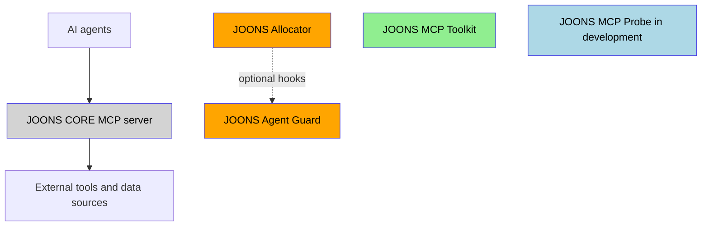

# JOONS

MCP-Based AI Infrastructure Ecosystem

JOONS는 AI 에이전트를 도구, 컴퓨터, 지식, 신뢰할 수 있는 실행 시스템과 연결하는 MCP 중심 AI 인프라 생태계입니다.


[English](README.md)

## Why JOONS

에이전트를 도구에 연결하는 것은 MCP 시스템의 한 부분입니다. 개발자에게는 신뢰할 수 있는 실행, 작업 할당, 진단, 도구 연결도 필요합니다. JOONS는 이 역할을 MCP 중심으로 모읍니다. JOONS CORE는 중심 서버이며 라이브러리와 도구는 CORE를 보완하거나 독립적으로 사용합니다.

## Who it is for

- MCP를 통해 AI 에이전트를 도구와 데이터에 연결하는 개발자
- 독립적인 신뢰성 또는 작업 할당 라이브러리를 찾는 Python 개발자
- 참조 패턴이나 프로토콜 진단을 살펴보는 MCP 개발자
- 제품 상태와 경계를 명확하게 파악해야 하는 운영자

## Ecosystem map



이 개념도는 독립 제품이 CORE에 내장되어 있다는 뜻이 아닙니다. 현재 구현된 라이브러리 간 연동은 Allocator의 선택적 Guard 훅뿐입니다.

| 제품 | 핵심 질문 | 역할 | 상태 | 링크 |
|---|---|---|---|---|
| JOONS CORE | AI가 무엇을 할 수 있나요? | MCP 서버와 도구 실행 | 비공개, 운영 중; 소스 미공개 | 없음 |
| JOONS Agent Guard | 안전하게 실행되나요? | 신뢰성과 보호 | 공개, v0.1.0 Preview | [저장소](https://github.com/dbdefault/joons-agent-guard) |
| JOONS Allocator | 누가 어떤 작업을 하나요? | 작업 할당 | 공개, v0.1.0 Preview | [저장소](https://github.com/dbdefault/joons-allocator) |
| JOONS MCP Toolkit | 어떻게 만들어야 하나요? | 개발 참조 자료 | 공개 참조 구현, 초기 단계 | [저장소](https://github.com/dbdefault/joons-mcp-toolkit) |
| JOONS MCP Probe | MCP 서버가 올바르게 동작하나요? | 진단과 검증 | 개발 중; v0.1.0 Preview 예정 | 공개 예정 ([로드맵](docs/ROADMAP.md)) |

## What you can do today

### Install JOONS Agent Guard

공개 프리뷰로 지속적인 배타 잠금, 서킷 브레이커, 재시도 요청의 최대 한 번 처리를 사용할 수 있습니다. Python 3.9+와 SQLite를 사용합니다. 잠금은 권고 방식이며 저절로 만료되지 않고 단일 머신 범위에서 동작합니다.

```sh
pip install git+https://github.com/dbdefault/joons-agent-guard@v0.1.0
```

### Install JOONS Allocator

공개 프리뷰로 멱등 작업 제출, 우선순위 및 FIFO 리스, 배타적 이름 지정 리소스와 추가 전용 감사 기록을 사용할 수 있습니다. Python 3.9-3.13과 SQLite를 사용합니다. 단일 머신에서 동작하며 현재 리스 만료는 없습니다.

```sh
pip install git+https://github.com/dbdefault/joons-allocator@v0.1.0
```

Allocator는 Guard 없이 동작합니다. 선택적 Guard 훅은 [Integration](docs/INTEGRATION.md)을 참고하세요. 기여 및 보안 안내는 각 제품 저장소에서 확인하세요.

Allocator는 다음 기능도 제공합니다.

- 워커당 실행 중인 작업 하나와 리스 토큰 펜싱
- 승인, 취소, 일시 정지, 재개, 재시도, 복구 작업
- 하트비트가 있는 워커 레지스트리, asyncio 인터페이스, 운영자 CLI

Agent Guard는 다음 기능도 제공합니다.

- CircuitBreaker를 통한 액터별 단일 실행 슬롯
- asyncio 어댑터와 운영자 CLI

두 라이브러리는 Python 표준 라이브러리와 SQLite를 사용합니다.
설계를 선택하기 전에 단일 머신 제한을 확인하세요.
Guard 잠금은 저절로 만료되지 않으며 Allocator에는 리스 만료가 없습니다.
계획된 리스 만료와 타임아웃은 현재 기능이 아닙니다.

### Explore JOONS MCP Toolkit

초기 공개 참조 구현은 요청 조정, 호스트 라우팅, 하이브리드 검색, 지속적인 요청 원장 패턴을 보여 줍니다. 교육용 참조 자료이며 운영용 JOONS CORE가 아닙니다.

### Follow JOONS MCP Probe

Probe는 개발 중이며 0.1.0 Preview가 예정되어 있습니다. 도구를 호출하지 않는 읽기 전용 MCP 프로토콜 및 도구 계약 진단용으로 설계되었습니다. 저장소는 Preview와 함께 공개됩니다.

## Choosing a product

1. 비공개 MCP 서버와 도구 실행이 필요하다면 JOONS CORE를 고려하세요.
2. 단일 머신용 신뢰성 기능이 필요하다면 JOONS Agent Guard부터 살펴보세요.
3. 작업을 워커에게 할당하려면 JOONS Allocator부터 살펴보세요.
4. MCP 구현 패턴을 학습하려면 JOONS MCP Toolkit을 살펴보세요.
5. 프로토콜과 도구 계약 진단이 필요하다면 JOONS MCP Probe의 개발을 확인하세요.

라이브러리는 CORE 없이 사용할 수 있습니다. 범위와 제한은 [제품 비교](docs/PROJECTS.md)를 참고하세요.

## Design principles

- MCP 중심: 도구 연결을 MCP 중심으로 구성합니다.
- 독립성과 조합 가능성: 라이브러리를 CORE 없이 사용할 수 있습니다.
- 읽기 전용과 예상 가능한 기본 동작: Probe는 도구 호출 없이 검사하도록 설계되었습니다.
- 지속적이고 감사 가능한 상태: 명시된 곳에서 지속적인 잠금과 원장을 제공하며 Allocator는 추가 전용 감사 기록을 남깁니다.
- 정직한 상태 표기: 공개 프리뷰, 비공개 운영, 계획을 구분합니다.
- 기본적인 개인정보 보호: 공개와 비공개 경계를 명확히 합니다.

## FAQ

### JOONS CORE는 오픈소스인가요?

아니요. JOONS CORE는 비공개로 운영 중이며 소스가 공개되지 않았습니다.

### 라이브러리를 사용하려면 CORE가 필요한가요?

아니요. JOONS Agent Guard와 JOONS Allocator는 독립 라이브러리입니다. Allocator의 Guard 훅은 선택 사항입니다.

### 공개 제품이 CORE에 포함되어 있나요?

아니요. 현재 CORE는 Guard, Allocator, Toolkit, Probe를 가져오거나 함께 제공하지 않습니다. 향후 연동은 계획입니다.

### MCP Toolkit이 운영용 CORE 서버인가요?

아니요. 초기 공개 참조 구현이며 CORE를 노출하거나 필요로 하지 않습니다.

### MCP Probe가 도구를 호출할 수 있나요?

예정된 0.1.0 Preview는 읽기 전용이며 도구를 호출하지 않습니다. 선택적 허용 목록 기반 도구 호출 검사는 이후 아이디어입니다.

## Contributing

이 저장소는 문서 수정을 받습니다. 제품 이슈와 풀 리퀘스트는 해당 제품 저장소에 제출하고 CONTRIBUTING.md와 SECURITY.md를 확인하세요. 보안 문제는 해당 저장소의 GitHub 비공개 취약점 보고 기능을 이용하세요.

## Documentation

- [Architecture](docs/ARCHITECTURE.md)
- [Projects](docs/PROJECTS.md)
- [Integration](docs/INTEGRATION.md)
- [Roadmap](docs/ROADMAP.md)
- [Brand](docs/BRAND.md)
- [English README](README.md)
- [License](LICENSE)
