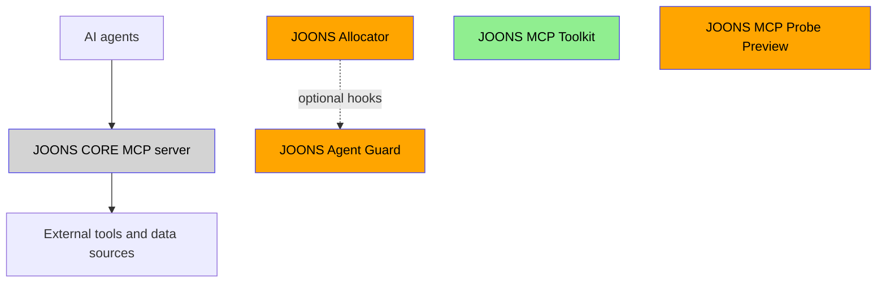

# JOONS

MCP-Based AI Infrastructure Ecosystem

JOONS is an MCP-centered AI infrastructure ecosystem that connects AI agents with tools, computers, knowledge, and reliable execution systems.


[한국어](README.ko.md)

## Why JOONS

Connecting an agent to tools is only one part of an MCP system. Developers also need reliable execution, task allocation, diagnostics, and tool connectivity. JOONS brings these concerns together around MCP: JOONS CORE is the central server, while libraries and tools complement it or stand independently.

## Who it is for

- Developers connecting AI agents to tools and data through MCP.
- Python developers looking for independent reliability or allocation libraries.
- MCP developers exploring reference patterns or protocol diagnostics.
- Operators who need visibility into product status and boundaries.

## Ecosystem map



This conceptual map does not imply that independent products are embedded in CORE. Allocator's optional Guard hooks are the only implemented library-to-library integration.

| Product | Core question | Role | Status | Link |
|---|---|---|---|---|
| JOONS CORE | What can the AI do? | MCP server and tool execution | Private, in operation; source not published | None |
| JOONS Agent Guard | Does it run safely? | Reliability and protection | Public, v0.1.0 Preview | [Repository](https://github.com/dbdefault/joons-agent-guard) |
| JOONS Allocator | Who does which job? | Task allocation | Public, v0.1.0 Preview | [Repository](https://github.com/dbdefault/joons-allocator) |
| JOONS MCP Toolkit | How should we build it? | Development reference | Public reference implementation, early | [Repository](https://github.com/dbdefault/joons-mcp-toolkit) |
| JOONS MCP Probe | Does the MCP server work correctly? | Diagnostics and validation | Public, v0.1.0 Preview | [Repository](https://github.com/dbdefault/joons-mcp-probe) |

## What you can do today

### Install JOONS Agent Guard

Use the public preview for durable exclusive locks, a circuit breaker, and at-most-once handling of retried requests. It uses Python 3.9+ and SQLite. Its locks are advisory and do not expire on their own; its scope is one machine.

```sh
pip install git+https://github.com/dbdefault/joons-agent-guard@v0.1.0
```

### Install JOONS Allocator

Use the public preview for idempotent task submission, priority and FIFO leasing, exclusive named resources, and an append-only audit. It uses Python 3.9-3.13 and SQLite. It operates on one machine and has no lease expiry today.

```sh
pip install git+https://github.com/dbdefault/joons-allocator@v0.1.0
```

Allocator works without Guard. Optional Guard hooks are described in [Integration](docs/INTEGRATION.md). Consult each product repository for contribution and security guidance.

Allocator also offers:

- One running task per worker and lease-token fencing.
- Approval, cancellation, pause, resume, retry and recovery operations.
- A worker registry with heartbeat, an asyncio facade, and an operator CLI.

Agent Guard also offers:

- A per-actor single run slot through CircuitBreaker.
- Asyncio adapters and an operator CLI.

Both libraries use the Python standard library and SQLite.
Review their single-machine limitations before choosing a design.
Guard's locks never expire on their own; Allocator has no lease expiry.
Planned lease expiry and timeouts are not current features.

### Explore JOONS MCP Toolkit

The early public reference implementation presents patterns for request coordination, host routing, hybrid retrieval, and a durable request ledger. It is an educational reference, not production JOONS CORE.

### Probe an MCP server

Install the public preview from GitHub (not npm):

```sh
npm install -g github:dbdefault/joons-mcp-probe#v0.1.0
```

Probe inspects MCP servers over stdio or Streamable HTTP without calling tools. See the [repository](https://github.com/dbdefault/joons-mcp-probe) for CLI usage.

## Choosing a product

1. Need the private MCP server and its tool execution? Consider JOONS CORE.
2. Need reliability primitives for a single machine? Start with JOONS Agent Guard.
3. Need to allocate tasks to workers? Start with JOONS Allocator.
4. Need MCP implementation patterns to study? Explore JOONS MCP Toolkit.
5. Need protocol and tool-contract diagnostics? Use JOONS MCP Probe.

The libraries can be used without CORE. See the [project comparison](docs/PROJECTS.md) for scope and limitations.

## Design principles

- MCP-centered: organize tool connectivity around MCP.
- Independent and composable: libraries can be used without CORE.
- Read-only and least-surprise defaults: Probe is designed to inspect without calling tools.
- Durable, auditable state: durable locks and ledgers are available where described; Allocator records an append-only audit.
- Honest status labels: distinguish public previews, private operation, and planned work.
- Privacy by default: keep public and private boundaries explicit.

## FAQ

### Is JOONS CORE open source?

No. JOONS CORE is private, in operation, and its source is not published.

### Do I need CORE to use the libraries?

No. JOONS Agent Guard and JOONS Allocator are independent libraries. Allocator's Guard hooks are optional.

### Are the public products bundled into CORE?

No. CORE does not import or ship Guard, Allocator, Toolkit, or Probe today. Future integration is a plan.

### Is MCP Toolkit the production CORE server?

No. It is an early public reference implementation. It does not expose or require CORE.

### Can MCP Probe call tools?

The v0.1.0 Preview is read-only and does not call tools. Opt-in, allow-listed tool-call checks are a later idea.

## Contributing

This repository accepts documentation fixes. Send product issues and pull requests to the relevant product repository and consult its CONTRIBUTING.md and SECURITY.md. Use GitHub private vulnerability reporting on the affected repository for security reports.

## Documentation

- [Architecture](docs/ARCHITECTURE.md)
- [Projects](docs/PROJECTS.md)
- [Integration](docs/INTEGRATION.md)
- [Roadmap](docs/ROADMAP.md)
- [Brand](docs/BRAND.md)
- [Korean README](README.ko.md)
- [License](LICENSE)
