# JOONS

MCP-Based AI Infrastructure Ecosystem

JOONS is an MCP-centered AI infrastructure ecosystem that connects AI agents with tools, computers, knowledge, and reliable execution systems.


[한국어](README.ko.md)

## Why JOONS

Connecting an agent to tools is only one part of an MCP system. Developers also need reliable execution, task allocation, diagnostics, and tool connectivity. JOONS brings these concerns together around MCP: JOONS CORE is the central server, while libraries and tools complement it or stand independently.

## Who it is for

- Developers connecting AI agents to tools and data through MCP.
- Python developers looking for independent reliability or allocation libraries.
- MCP developers exploring reference patterns or protocol diagnostics.
- Operators who need visibility into product status and boundaries.

## Ecosystem map

```mermaid
flowchart TD
    Agent["AI agents"] --> CORE["JOONS CORE MCP server"]
    CORE --> External["External tools and data sources"]
    Allocator["JOONS Allocator"] -. "optional hooks" .-> Guard["JOONS Agent Guard"]
    Toolkit["JOONS MCP Toolkit"]
    Probe["JOONS MCP Probe Preview"]
    Diff["JOONS MCP Diff Preview"]
    PolicyGate["JOONS MCP Policy Gate Preview"]
    MockServer["JOONS MCP Mock Server Preview"]
    ContractRunner["JOONS MCP Contract Test Runner Preview"]
    ReportHub["JOONS MCP Report Hub Preview"]
    SchemaKit["JOONS MCP Schema Toolkit Preview"]
    ToolCatalog["JOONS MCP Tool Catalog Preview"]
    TestData["JOONS MCP Test Data Generator Preview"]
    ContextBudget["JOONS MCP Context Budget Preview"]
    SearchEngine["JOONS Search Engine Preview"]
    AuditTrail["JOONS MCP Audit Trail Preview"]
    ConfigDoctor["JOONS MCP Config Doctor Preview"]
    classDef private fill:#d3d3d3,stroke:#4F46E5,color:#000
    classDef public fill:#90ee90,stroke:#4F46E5,color:#000
    classDef preview fill:#ffa500,stroke:#4F46E5,color:#000
    classDef planned fill:#add8e6,stroke:#4F46E5,color:#000
    class CORE private
    class Toolkit public
    class Guard,Allocator preview
    class Probe,Diff,PolicyGate,MockServer,ContractRunner,ReportHub,TestData,SchemaKit,ToolCatalog,ContextBudget,SearchEngine,AuditTrail,ConfigDoctor preview
```



This conceptual map does not imply that independent products are embedded in CORE. Allocator's optional Guard hooks are the only implemented library-to-library integration.

| Product | Core question | Role | Status | Link |
|---|---|---|---|---|
| JOONS CORE | What can the AI do? | MCP server and tool execution | Private, in operation; source not published | None |
| JOONS Agent Guard | Does it run safely? | Reliability and protection | Public, v0.1.0 Preview | [Repository](https://github.com/dbdefault/joons-agent-guard) |
| JOONS Allocator | Who does which job? | Task allocation | Public, v0.1.0 Preview | [Repository](https://github.com/dbdefault/joons-allocator) |
| JOONS MCP Toolkit | How should we build it? | Development reference | Public reference implementation, early | [Repository](https://github.com/dbdefault/joons-mcp-toolkit) |
| JOONS MCP Probe | Does the MCP server work correctly? | Diagnostics and validation | Public, v0.1.0 Preview | [Repository](https://github.com/dbdefault/joons-mcp-probe) |
| JOONS MCP Diff | What changed, and will it break my agents? | MCP Development Tools: contract comparison | Public, v0.1.0 Preview | [Repository](https://github.com/dbdefault/joons-mcp-diff) |
| JOONS MCP Policy Gate | Does this tool list follow our rules? | MCP Development Tools: contract policy checks | Public, v0.1.0 Preview | [Repository](https://github.com/dbdefault/joons-mcp-policy-gate) |
| JOONS MCP Mock Server | Can I test my agent against this server without touching anything real? | MCP Development Tools: mock server | Public, v0.1.0 Preview | [Repository](https://github.com/dbdefault/joons-mcp-mock-server) |
| JOONS MCP Contract Test Runner | Do my tools still behave the way my agents expect? | MCP Development Tools: contract testing | Public, v0.1.0 Preview | [Repository](https://github.com/dbdefault/joons-mcp-contract-runner) |
| JOONS MCP Report Hub | Where can I see all my MCP reports in one place? | MCP Development Tools: report aggregation | Public, v0.1.0 Preview | [Repository](https://github.com/dbdefault/joons-mcp-report-hub) |
| JOONS MCP Schema Toolkit | Are my MCP tool schemas well formed, and what do they accept? | MCP Development Tools: schema inspection | Public, v0.1.0 Preview | [Repository](https://github.com/dbdefault/joons-mcp-schema-toolkit) |
| JOONS MCP Tool Catalog | Which tools do my MCP servers expose together, and do any names collide? | MCP Development Tools: tool catalog | Public, v0.1.1 Preview | [Repository](https://github.com/dbdefault/joons-mcp-tool-catalog) |
| JOONS MCP Test Data Generator | How do I get valid and invalid test inputs for my MCP tools? | MCP Development Tools: test data generation | Public, v0.1.0 Preview | [Repository](https://github.com/dbdefault/joons-mcp-test-data-generator) |
| JOONS MCP Context Budget | How much context do my MCP tool definitions take up? | MCP Development Tools: context budgeting | Public, v0.1.0 Preview | [Repository](https://github.com/dbdefault/joons-mcp-context-budget) |
| JOONS Search Engine | How do I index my local documents offline and search them with explainable ranking? | Standalone tool: local document search | Public, v0.1.0 Preview | [Repository](https://github.com/dbdefault/joons-search-engine) |
| JOONS MCP Audit Trail | How do I show that the record of my AI agent and MCP tool activity was not altered afterwards? | MCP Development Tools: tamper-evident audit log | Public, v0.1.0 Preview | [Repository](https://github.com/dbdefault/joons-mcp-audit-trail) |
| JOONS MCP Config Doctor | Is my MCP client config file correct, safe and portable? | MCP Development Tools: config linting and conversion | Public, v0.1.0 Preview | [Repository](https://github.com/dbdefault/joons-mcp-config-doctor) |

## What you can do today

### Install JOONS Agent Guard

Use the public preview for durable exclusive locks, a circuit breaker, and at-most-once handling of retried requests. It uses Python 3.9+ and SQLite. Its locks are advisory and do not expire on their own; its scope is one machine.

```sh
pip install git+https://github.com/dbdefault/joons-agent-guard@v0.1.0
```

### Install JOONS Allocator

Use the public preview for idempotent task submission, priority and FIFO leasing, exclusive named resources, and an append-only audit. It uses Python 3.9-3.13 and SQLite. It operates on one machine and has no lease expiry today.

```sh
pip install git+https://github.com/dbdefault/joons-allocator@v0.1.0
```

Allocator works without Guard. Optional Guard hooks are described in [Integration](docs/INTEGRATION.md). Consult each product repository for contribution and security guidance.

Allocator also offers:

- One running task per worker and lease-token fencing.
- Approval, cancellation, pause, resume, retry and recovery operations.
- A worker registry with heartbeat, an asyncio facade, and an operator CLI.

Agent Guard also offers:

- A per-actor single run slot through CircuitBreaker.
- Asyncio adapters and an operator CLI.

Both libraries use the Python standard library and SQLite.
Review their single-machine limitations before choosing a design.
Guard's locks never expire on their own; Allocator has no lease expiry.
Planned lease expiry and timeouts are not current features.

### Explore JOONS MCP Toolkit

The early public reference implementation presents patterns for request coordination, host routing, hybrid retrieval, and a durable request ledger. It is an educational reference, not production JOONS CORE.

### Probe an MCP server

Install the public preview from GitHub (not npm):

```sh
npm install -g github:dbdefault/joons-mcp-probe#v0.1.0
```

Probe inspects MCP servers over stdio or Streamable HTTP without calling tools. See the [repository](https://github.com/dbdefault/joons-mcp-probe) for CLI usage.

### Compare MCP tool contracts

JOONS MCP Diff: Detect MCP tool and schema changes before they break your AI agents. Install the [v0.1.0 Preview](https://github.com/dbdefault/joons-mcp-diff/releases/tag/v0.1.0):

```sh
npm install -g github:dbdefault/joons-mcp-diff#v0.1.0
```

Diff captures read-only `tools/list` snapshots over stdio or Streamable HTTP as versioned canonical JSON, then compares two points in time. Snapshots never store commands, paths, URLs, headers, environment values or tokens. Changes are BREAKING, NON_BREAKING or UNKNOWN; unprovable changes are UNKNOWN and rename hints are suggestions only. It provides terminal, Markdown and JSON reports, `--fail-on` for CI, and exit codes 0–4. It is Apache-2.0, uses JavaScript ESM, Node.js 20+ and the official MCP SDK.

Probe inspects one MCP server's current protocol behaviour and tool contract; Diff compares the tool contract at two points in time. They are independent and complementary: Diff does not need Probe. For example, run Probe for health and Diff in CI for contract drift.

### Check a tool list against a policy

JOONS MCP Policy Gate: Static policy checks for MCP tool contracts, built for CI. Install the [v0.1.0 Preview](https://github.com/dbdefault/joons-mcp-policy-gate/releases/tag/v0.1.0):

```sh
npm install -g github:dbdefault/joons-mcp-policy-gate#v0.1.0
```

Policy Gate reads a `joons-mcp-diff` schemaVersion 1 snapshot and a versioned JSON policy. It checks allow and deny name globs, required tools, maximum tool count, descriptions, input schemas, required annotation keys, and user-defined risk classes with dated approvals. Deny wins and its level cannot be lowered by an allow violation. Strict validation rejects unknown keys, conflicts and policies that can never produce a finding. It provides PASS/WARN/FAIL, terminal, JSON and Markdown reports, `--fail-on failure|warning|none`, exit codes 0-4, and a `validate-policy` command. It uses JavaScript ESM, Node.js 20+, zero runtime dependencies and Apache-2.0; it is not on npm.

Probe inspects one server's current behaviour; Diff compares two points in time; Policy Gate checks one snapshot against a written policy. Policy Gate is installed and run independently and needs neither Probe nor Diff at runtime; Diff is an easy way to make a snapshot. This static check does not block tool calls at runtime or determine real risk: risk classes are user labels.

### Test an agent with a mock server

JOONS MCP Mock Server: Create realistic mock MCP servers from tool snapshots for safe agent development and testing. Install the [v0.1.0 Preview](https://github.com/dbdefault/joons-mcp-mock-server/releases/tag/v0.1.0):

```sh
npm install -g github:dbdefault/joons-mcp-mock-server#v0.1.0
```

Mock Server reads a `joons-mcp-diff` schemaVersion 1 snapshot and an optional JSON fixture file. It serves a MOCK MCP server over stdio with initialize, ping, tools/list and tools/call. Tool results come from fixture defaults, argument matches and named scenarios. Built-in scenarios are default, empty, error, slow and server-error; `--fail-tool` and argument validation of a JSON Schema subset are also available. Calls are recorded in memory with masking of secret-looking arguments, with an optional JSON report. It uses JavaScript ESM, Node.js 20+, the official MCP SDK and Apache-2.0; it is not on npm. Streamable HTTP, resources and prompts are not in 0.1.0.

This is a MOCK: no real actions are performed. It makes no network requests, changes no files except the optional report, starts no child processes, and never forwards to a real server or executes snapshot or fixture content. Probe diagnoses a real server; Diff compares two snapshots; Policy Gate checks one snapshot against a policy; Mock Server runs a mock server from one snapshot. Mock Server is installed and run independently and needs none of the others at runtime; Diff is an easy way to make a snapshot. CORE does not import or ship it.

### Run behavioral contract tests

JOONS MCP Contract Test Runner: Define, execute, and validate behavioral contracts for MCP tools. Install the [v0.1.0 Preview](https://github.com/dbdefault/joons-mcp-contract-runner/releases/tag/v0.1.0) together with the Mock Server it runs against:

```sh
npm install -g github:dbdefault/joons-mcp-contract-runner#v0.1.0
npm install -g github:dbdefault/joons-mcp-mock-server#v0.1.0
```

Contract Test Runner reads a strictly validated JSON test suite. Each test names a tool, its arguments and the expected outcome, with assertions for outcome, isError, text, contentCount, structuredContent (equals or subset match), fields, maxDurationMs, errorCode and errorMessageContains. Captures pass values from a passing test to later tests; per-test and total timeouts, concurrency, PASS/FAIL/SKIP results, terminal, JSON and Markdown reports and CI exit codes are included. Captured values and secret-looking keys are redacted in reports. It uses JavaScript ESM, Node.js 20+, the official MCP SDK and Apache-2.0; it is not on npm.

In 0.1.0 the only target is a JOONS MCP Mock Server: the runner starts it itself and checks that it is a JOONS MCP Mock Server before any tool call, so no real tool is called. Real-server execution is planned with explicit opt-in and an exact per-tool allowlist. Probe diagnoses a real server; Diff compares two snapshots; Policy Gate checks one snapshot against a policy; Mock Server runs a mock server; Contract Test Runner runs behavioral contract tests against the mock. It is installed and run independently and has no runtime dependency on the Mock Server package; it uses the Mock Server only as its test target. CORE does not import or ship it.

### Mock Server and Contract Test Runner together

1. Make a snapshot of your server's tools with JOONS MCP Diff (`joons-mcp-diff snapshot ...`).
2. Write fixtures for the Mock Server and a test suite for the runner.
3. Run the suite:

```sh
joons-mcp-contract-test run shop.suite.json --snapshot snapshot.json --fixtures fixtures.json
```

The runner starts the Mock Server itself, checks that it is a JOONS MCP Mock Server before any tool call, runs every test and reports PASS or FAIL. No real tool is called.

## Choosing a product

1. Need the private MCP server and its tool execution? Consider JOONS CORE.
2. Need reliability primitives for a single machine? Start with JOONS Agent Guard.
3. Need to allocate tasks to workers? Start with JOONS Allocator.
4. Need MCP implementation patterns to study? Explore JOONS MCP Toolkit.
5. Need protocol and tool-contract diagnostics? Use JOONS MCP Probe.
6. Need to detect contract drift and compatibility risks? Use JOONS MCP Diff.
7. Need to check whether a tool list follows your rules? Use JOONS MCP Policy Gate.
8. Need to test an agent without touching anything real? Use JOONS MCP Mock Server.
9. Need to check that your tools still behave the way your agents expect? Use JOONS MCP Contract Test Runner.

The libraries can be used without CORE. See the [project comparison](docs/PROJECTS.md) for scope and limitations.

## Design principles

- MCP-centered: organize tool connectivity around MCP.
- Independent and composable: libraries can be used without CORE.
- Read-only and least-surprise defaults: Probe is designed to inspect without calling tools.
- Durable, auditable state: durable locks and ledgers are available where described; Allocator records an append-only audit.
- Honest status labels: distinguish public previews, private operation, and planned work.
- Privacy by default: keep public and private boundaries explicit.

## FAQ

### Is JOONS CORE open source?

No. JOONS CORE is private, in operation, and its source is not published.

### Do I need CORE to use the libraries?

No. JOONS Agent Guard and JOONS Allocator are independent libraries. Allocator's Guard hooks are optional.

### Are the public products bundled into CORE?

No. CORE does not import or ship Guard, Allocator, Toolkit, Probe, Diff, Policy Gate, Mock Server, Contract Test Runner, Report Hub, Test Data Generator, Schema Toolkit, Tool Catalog, Context Budget, Search Engine, Audit Trail, or Config Doctor today. Future integration is a plan.

### Is MCP Toolkit the production CORE server?

No. It is an early public reference implementation. It does not expose or require CORE.

### Can MCP Probe call tools?

The v0.1.0 Preview is read-only and does not call tools. Opt-in, allow-listed tool-call checks are a later idea.

## Contributing

This repository accepts documentation fixes. Send product issues and pull requests to the relevant product repository and consult its CONTRIBUTING.md and SECURITY.md. Use GitHub private vulnerability reporting on the affected repository for security reports.

## Documentation

- [Architecture](docs/ARCHITECTURE.md)
- [Projects](docs/PROJECTS.md)
- [Integration](docs/INTEGRATION.md)
- [Roadmap](docs/ROADMAP.md)
- [Brand](docs/BRAND.md)
- [Korean README](README.ko.md)
- [License](LICENSE)
