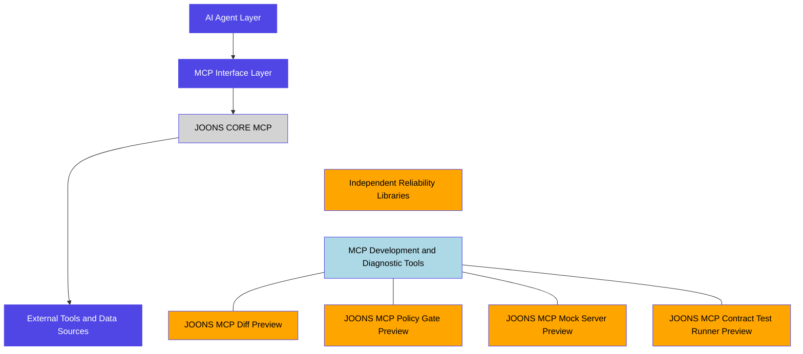
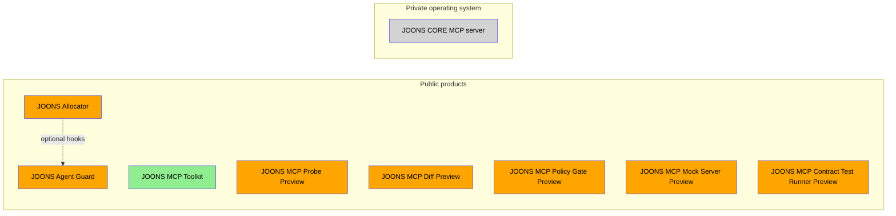
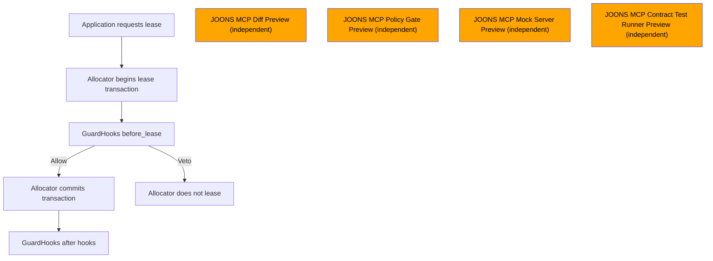

# Architecture

This is a conceptual architecture. It shows boundaries between public products and the private operating system; it does not mean every product is embedded in CORE today.

## Layers

1. AI Agent Layer - ChatGPT, Claude, Codex, OpenCode, Hermes and other agents
2. MCP Interface Layer - MCP protocol over stdio / Streamable HTTP
3. JOONS CORE MCP - private MCP server (tool registry, transports, target selection)
4. Independent Reliability Libraries - Agent Guard, Allocator (usable without CORE)
5. MCP Development & Diagnostic Tools - MCP Toolkit, MCP Probe, MCP Diff, MCP Policy Gate, MCP Mock Server, MCP Contract Test Runner
6. External Tools and Data Sources - computers, phones, files, knowledge bases, web, Git, external MCP servers

## Public and private boundary

## Layer responsibilities

### 1. AI Agent Layer

Agents are clients of the MCP interface. Examples include ChatGPT, Claude, Codex, OpenCode, Hermes and other agents. Their presence in the conceptual model does not imply a particular deployment or integration for each agent.

### 2. MCP Interface Layer

MCP supplies the protocol boundary over stdio or Streamable HTTP. JOONS CORE is an MCP server; Probe is designed to inspect MCP servers over these transports. Protocol inspection and tool execution are distinct activities.

### 3. JOONS CORE MCP

CORE is the private, operating server. It provides the protocol endpoint, tool registry, transports, and target selection across several machines. It connects agents to computers and phones, files, knowledge, web and Git, and can connect external MCP servers. Its source is not published.

### 4. Independent Reliability Libraries

Agent Guard supplies durable exclusive locks, a circuit breaker, and replay protection. Allocator supplies task submission, leasing, worker registration, named resources and audit. They are usable without CORE. Their optional hook integration is independent of CORE and is the only implemented library-to-library integration.

### 5. MCP Development & Diagnostic Tools

MCP Toolkit is an early public educational reference. It offers implementation patterns, not the production CORE server. MCP Probe is Public, v0.1.0 Preview and inspects protocol behaviour and tool contracts without calling tools. It does not duplicate CORE host monitoring or tool-list browsing.

MCP Diff is a public v0.1.0 Preview that compares versioned read-only tool snapshots across two points in time. It reports BREAKING, NON_BREAKING and UNKNOWN changes; unprovable compatibility is UNKNOWN and rename hints are suggestions. Probe inspects a server's current protocol behaviour and tool contract; Diff is independent of Probe and complements it for CI contract drift detection.

JOONS MCP Policy Gate is a public v0.1.0 Preview for static policy checks of one schemaVersion 1 Diff-format snapshot against a versioned JSON policy. Probe inspects one server's current behaviour; Diff compares two points in time; Policy Gate checks a snapshot against written rules. Policy Gate is installed and run independently and needs neither Probe nor Diff at runtime; Diff is an easy way to make a snapshot. It does not block tool calls at runtime or determine real risk: risk classes are user labels.

JOONS MCP Mock Server is a public v0.1.0 Preview that serves a MOCK MCP server over stdio from one Diff-format schemaVersion 1 snapshot and optional JSON fixtures. Fixture responses support defaults, argument matches and named scenarios. It performs no real actions: no network, file changes except an optional report, child processes, forwarding, or execution of snapshot or fixture content. Probe diagnoses a real server; Diff compares two snapshots; Policy Gate checks one snapshot against a policy; Mock Server runs a mock server from one snapshot. Mock Server is installed and run independently, needs none of the others at runtime, and Diff is an easy way to make a snapshot. CORE does not import or ship it.

JOONS MCP Contract Test Runner is a public v0.1.0 Preview that runs strictly validated JSON behavioral contract test suites against a JOONS MCP Mock Server it starts itself, using the official MCP SDK client. It checks that the target is a JOONS MCP Mock Server before any tool call, so no real tool is called; real-server execution is planned with explicit opt-in and an exact per-tool allowlist. Reports redact captured values and secret-looking keys. It is installed and run independently and has no runtime dependency on the Mock Server package. CORE does not import or ship it.

### 6. External Tools and Data Sources

The conceptual external layer includes computers, phones, files, knowledge bases, web, Git and external MCP servers. CORE can connect to these categories; the diagram does not imply that any particular source is available in a given environment.

## Data and control flow

An agent can interact with CORE through MCP. CORE's registry, transports and target selection provide the server-side connection to tools and data sources. This is the conceptual server path, not evidence that every external source is connected in a particular deployment.

Separately, an application can use Allocator without CORE. When the optional Guard hooks are enabled, `before_lease` can veto within the lease transaction and `after_*` hooks run after commit. No other library-to-library integration is implemented today.

Probe is an external read-only inspector of MCP servers. Its v0.1.0 Preview does not call tools; inspecting CORE is a future operator action, not an embedded integration.

## Trust and product boundaries

- CORE is private; its source is not published. Toolkit does not expose or require it.
- Guard, Allocator, Toolkit, Probe, Diff, Policy Gate, Mock Server and Contract Test Runner are not bundled into or shipped with CORE, and CORE does not import them.
- Guard and Allocator operate on a single machine. Their storage and limits must not be read as a distributed coordination guarantee.
- Guard locks are advisory and never expire on their own. Allocator has no lease expiry today.
- Probe's intended read-only boundary excludes tool calls in 0.1.0. Later opt-in checks remain ideas.
- Toolkit's in-memory coordinator is educational. It is separate from its durable request ledger.

## Failure-handling philosophy

Durable state helps preserve the information a component records: Guard has durable locks and Allocator has an append-only audit. Allocator includes explicit retry and recover operations. These capabilities should be considered alongside the single-machine scope and the absence of automatic lock or lease expiry.

Use an honest UNKNOWN when available evidence does not establish an outcome; do not infer execution from a request or a conceptual diagram. Probe reports classify results as PASS, WARNING or FAIL; Diff uses UNKNOWN for changes whose compatibility cannot be established.

## Current and future integration

The optional Allocator to Guard hooks are implemented. CORE could use Guard and Allocator internally in the future, and Probe could gain an optional MCP adapter. These are plans, not present features. See [Integration](INTEGRATION.md) and the [Roadmap](ROADMAP.md).

[Integration](INTEGRATION.md) describes the implemented connection and future possibilities. [Back to README](../README.md)
