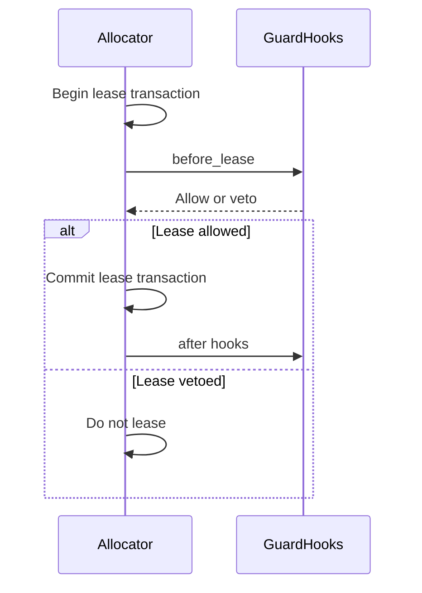

# Integration

None of JOONS Agent Guard, JOONS Allocator, JOONS MCP Toolkit, JOONS MCP Probe, JOONS MCP Diff or JOONS MCP Policy Gate is bundled into or shipped with JOONS CORE today. CORE does not import them.

| State | Integration |
|---|---|
| Implemented today | Allocator has optional Agent Guard hooks. This is the only implemented library-to-library integration. The core Allocator works without Guard. |
| Planned | CORE could use Guard and Allocator internally where useful. |
| Planned | Probe could gain an optional MCP adapter. |
| Implemented today | Public, v0.1.0 Preview: Probe is an external read-only tool for inspecting MCP servers without depending on CORE. An operator could inspect CORE in the future. |
| Implemented today | Diff is an independent external snapshot and comparison tool; it does not need Probe and has no library integration with ecosystem products today. Probe can be used for server health and Diff in CI for contract drift. |
| Implemented today | Policy Gate is an independent public v0.1.0 Preview for checking one schemaVersion 1 snapshot against a versioned JSON policy. It needs neither Probe nor Diff at runtime; Diff is an easy way to make a snapshot. It does not block tool calls at runtime or determine real risk; classes are user labels. |

Install the optional hooks with `pip install "joons-allocator[guard]"`. `joons_allocator.integrations.guard.GuardHooks` provides the hooks. `before_lease` can veto inside the lease transaction; `after_*` hooks run after commit.

## Combining Guard and Allocator today

Install the optional Guard extra above, then use the Allocator and GuardHooks interfaces in an application:

```python
from joons_allocator import Allocator
from joons_allocator.integrations.guard import GuardHooks
```

Configure the hooks according to the Allocator repository's documentation. The hook construction and attachment details are not specified here. The `before_lease` veto participates in the lease transaction; post-commit hooks run only after the transaction commits. Allocator remains usable without the extra.



## Planned adapters and connections

CORE could use Guard and Allocator internally where useful. Probe could gain an optional MCP adapter. The public v0.1.0 Preview is an external diagnostic tool that can inspect MCP servers, including CORE in the future when operated by its operator, without depending on CORE. These possibilities do not represent a present CORE integration. Probe's later ideas also include opt-in, allow-listed tool-call checks, resources and prompts inspection, and CI-friendly baselines and diffing.

[Back to README](../README.md)
