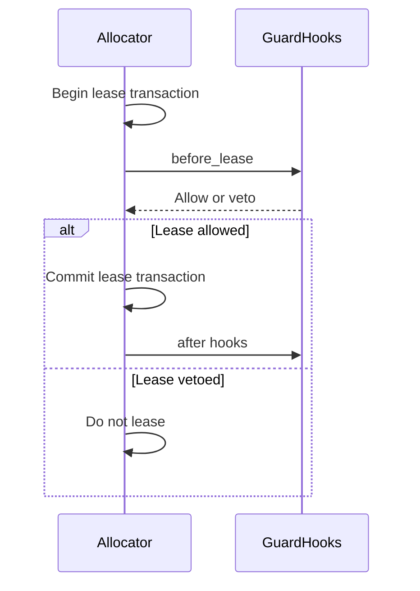

# Integration

None of JOONS Agent Guard, JOONS Allocator, JOONS MCP Toolkit or JOONS MCP Probe is bundled into or shipped with JOONS CORE today. CORE does not import them.

| State | Integration |
|---|---|
| Implemented today | Allocator has optional Agent Guard hooks. This is the only implemented library-to-library integration. The core Allocator works without Guard. |
| Planned | CORE could use Guard and Allocator internally where useful. |
| Planned | Probe could gain an optional MCP adapter. |
| Planned | Probe is designed as an external tool to inspect any MCP server, including CORE in the future when operated by its operator, without depending on CORE. |

Install the optional hooks with `pip install "joons-allocator[guard]"`. `joons_allocator.integrations.guard.GuardHooks` provides the hooks. `before_lease` can veto inside the lease transaction; `after_*` hooks run after commit.

## Combining Guard and Allocator today

Install the optional Guard extra above, then use the Allocator and GuardHooks interfaces in an application:

```python
from joons_allocator import Allocator
from joons_allocator.integrations.guard import GuardHooks
```

Configure the hooks according to the Allocator repository's documentation. The hook construction and attachment details are not specified here. The `before_lease` veto participates in the lease transaction; post-commit hooks run only after the transaction commits. Allocator remains usable without the extra.



## Planned adapters and connections

CORE could use Guard and Allocator internally where useful. Probe could gain an optional MCP adapter. Probe is designed as an external diagnostic tool that can inspect any MCP server, including CORE in the future when operated by its operator, without depending on CORE. These possibilities do not represent a present CORE integration. Probe's later ideas also include opt-in, allow-listed tool-call checks, resources and prompts inspection, and CI-friendly baselines and diffing.

[Back to README](../README.md)
